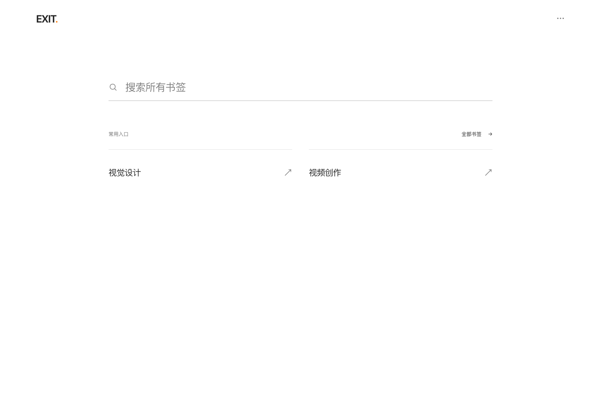

<h1 align="center">EXIT.</h1>
<p align="center">Your Web, in Order.</p>
<p align="center">一个以 Chrome 原生书签为唯一来源的极简书签入口。</p>



搜索所有书签，打开常用分类，需要时再整理。首页由你选择和排序；外观随系统切换深浅色。界面示例使用合成测试书签。

[暗色界面](docs/images/dark.png) · [下载安装包](https://github.com/kanshao2077/exit/releases/latest)

## 安装

1. 从 [Releases](https://github.com/kanshao2077/exit/releases/latest) 下载 `EXIT-Chrome.zip` 并解压。
2. 打开 `chrome://extensions`，开启「开发者模式」。
3. 点击「加载已解压的扩展程序」，选择解压后包含 `manifest.json` 的 `EXIT` 文件夹。
4. 在浏览器工具栏固定 EXIT.，点击图标打开完整标签页。

扩展名称为 **EXIT. — Your Web, in Order.**。安装包不需要 Node.js，不需要启动本地服务，也不替换新标签页。

## 使用

- **首页分类**：第一次安装由你选择入口。一个展示分类可连接多个原生文件夹或单独书签；显示、隐藏、改名和排序都不会移动原生数据。
- **全局搜索**：搜索框始终可见，匹配名称、完整 URL、原目录、虚拟分类、二级组和标签。方向键选择结果，Enter 打开，Esc 清空。
- **分类与全部书签**：以文字列表浏览，名称为主、域名为辅。完整网址的查询参数和片段保持原样。
- **管理书签**：在分类页、全部书签或搜索结果中点击「管理书签」，勾选后编辑、移动或删除。删除前预览确认，成功后可立即撤销。
- **整理设置**：右上角 `···` 进入首页分类、原生书签、分类建议及备份恢复。
- **外观**：自动跟随系统深浅色，没有主题按钮；支持窄屏和减少动态效果设置。

## AI 分类建议

本版提供可审阅的离线 JSON 工作流，**未接入在线模型 API**：

1. 在「分类建议」查看数据说明，确认后导出书签元数据。
2. 把文件交给你选择的 Codex 会话或本地模型，参考 [AI 提示与格式约定](docs/AI-WORKFLOW.md)。
3. 导入建议，检查「原分类 → 建议分类」，修改用途分类、分组和标签，选择要采用的条目。
4. 确认后只保存展示映射，不移动、删除或改名原生书签；首页选择仍由你决定。

信息不足的条目应标为待确认。重复项只标记完整 URL 相同的候选，不自动删除。导出会包含完整网址和原目录，是否交给外部服务由用户决定。

## 数据与跨设备

- 运行时唯一书签来源为 `chrome.bookmarks`，通过创建、修改、移动、删除、重排和导入事件刷新；重新聚焦页面也会补读。
- 书签本身的跨设备同步由 Chrome 负责：使用同一个 Google 账号，并将书签保存到账号中、开启相应同步。
- **EXIT. 的虚拟分类、首页选择与顺序目前保存在本机**，不自动跨设备同步；可以通过 EXIT. JSON 备份导出、导入迁移。导入会重新匹配节点，歧义项不猜测。
- 权限仅 `bookmarks`、`storage`。没有账号、云数据库、遥测、远程字体、站点抓取或模型网络请求。
- 开发网页使用明确标注的模拟数据，或可选的本地导出快照；真实书签 API 需要将构建安装为扩展。

## 备份与恢复

JSON 备份包含书签结构及展示设置；HTML 可由 Chrome 自带书签管理器导入。

每次原生写入前会保存一份本地恢复快照，备份失败则中止写入。最近一次新增、编辑、移动、删除可以撤销；若相关节点已被外部改动，会停止撤销，避免覆盖新内容。批量处理中途失败会保留已完成部分的撤销记录。

Chrome 不提供书签事务。恢复已删除内容会创建新节点，不能保留原 ID 和创建时间；恢复快照只有最近一份。重要批量整理前请额外导出文件备份。从 JSON 恢复整棵树时，会复制到单独恢复文件夹，不覆盖现有书签，可能产生重复。

## 开发与构建

需要 Node.js 22.12+ 和 pnpm 11.25.0。

```bash
pnpm install --frozen-lockfile
pnpm dev
```

开发地址为 `http://127.0.0.1:4180`。macOS 也可使用 `start.command`。源码构建：

```bash
pnpm lint
pnpm test
pnpm build
```

选择 `dist/` 即可在 Chrome 加载。**`pnpm build` 始终生成通用版，即使本机存在私有文件，也不会带入个人分类映射。**

如果仅在本机准备自己的用途分类方案，可选：

```bash
pnpm dev:personalized
pnpm build:personalized
```

个人输入、快照和匹配文件放在 Git 忽略的 `private/` 中，格式见分类工作流。个人构建只供自己的设备使用；发布到 GitHub 的源码和 Release 不包含原始书签或个人匹配文件。

## 验证

```bash
pnpm test:e2e
# 或顺序执行 lint、类型检查、核心测试、通用构建与真实扩展测试
pnpm check
```

首次运行真实浏览器测试可安装 Chromium：

```bash
pnpm exec playwright install chromium
```

macOS 默认使用已安装的 Google Chrome；其他系统使用 Playwright Chromium，也可通过 `EXIT_CHROME_BINARY` 指定浏览器。自动测试要求支持 `Extensions.loadUnpacked` / `triggerAction` 的近期 Chromium。

核心测试覆盖搜索、目录保护、嵌套操作、备份失败、部分失败恢复和外部变化。端到端测试在临时 Chrome 资料中安装真实扩展、创建合成书签，验证工具栏、API 同步、管理、撤销、JSON 工作流、深浅色及窄屏。测试不会操作日常 Chrome 资料。

本地结果和截图输出到 `artifacts/`；GitHub Actions 会运行通用检查并提供构建产物。可选的 `test:personalization` 和 `scripts/visual-check.mjs` 需要自己的本地测试资料，不属于通用 CI。范围见 [验证记录](docs/VERIFICATION.md)。

## 实现与边界

React、TypeScript、Vite、Zod，直接调用 Chrome Manifest V3 API。运行依赖许可随构建输出为 `THIRD_PARTY_LICENSES.txt`。参考项目和取舍见 [开源研究](docs/RESEARCH.md)。

保留搜索、手选首页、文字分类、原生管理、审阅式分类与备份恢复。没有 RSS、资讯流、天气时钟、聊天机器人、排行榜、复杂拖拽或自动改动书签的推荐机制。
